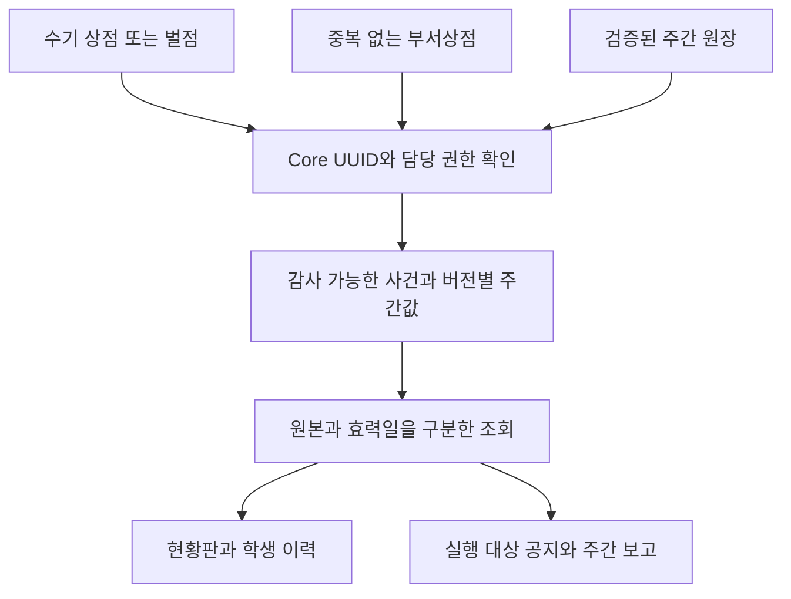
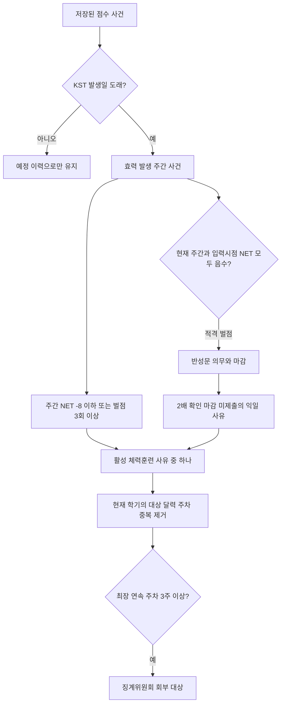

# 다니엘의 저울

**Language / 언어:** [English](README.md) | [한국어](README.ko.md)

**DICS — 제자국제크리스천학교**의 내부 생활지도 운영 콘솔이다. 관리자가 상·벌점, 반성문 제출, 사생회 처분, 반별 공지, 주간·정산기간 후속 업무를 관리한다. 학생은 이 앱에 로그인하지 않는다.

[프로젝트 사례 연구](docs/PROJECT_CASE_STUDY.ko.md) · [문서 목차](docs/README.ko.md) · [핵심 이슈](docs/KEY_ISSUES.ko.md) · [개발 일지](docs/DEVELOPMENT_JOURNAL.ko.md)

**앱:** https://dics-daniels-scale.netlify.app

## 학교 업무에서 공통 학생 신원으로

종이 벌점표를 전산화하면서 시작했다. 학습·학교 서비스 앱을 연결하는 과정에서 같은 학생을 앱마다 다르게 식별한다는 문제가 드러났다. DICS Core는 영구 학생 UUID와 로그인 계정·학기별 소속을 분리한다.

이 저장소는 프로토타입에서 DB 규칙 강제, 인증된 감사 주체, 단계적 UUID 이관, 동등성 검사, 이관 원장으로 발전한 과정을 기록한다. [사례 연구](docs/PROJECT_CASE_STUDY.ko.md)는 과거 근거와 한계를 구분하며 계획·당시 운영 수치·완료된 구현을 별도로 설명한다.

## 기록에서 운영 판단까지

수기 상·벌점, 월요일 부서상점, 확정 주간 원장은 같은 Core 학생 UUID를 참조한다. 원본별 정밀도와 감사 이력을 보존하며 주간 자료에서 일별 사건을 만들어내지 않는다. 인증된 역할과 담당 학년 범위로 접근을 제한한다.



### 효력일과 대상 판정 알고리즘

미래일 입력은 감사용으로 즉시 저장하지만 **Asia/Seoul 발생일**이 되어야 현재 사건 집계에 반영한다. 화면의 주간 NET은 **상점−벌점**이다. 반성문과 체력훈련은 별도 판정이므로 상점으로 상쇄된 벌점도 발생 횟수에는 포함될 수 있다.



2배 미제출 사유는 제출완료 시 해제하고 연속주 판정에는 최초 대상 주차 1회만 반영한다. 동시에 해당하는 체력훈련 사유는 모두 표시한다. 과거 주간 원장의 알 수 없는 횟수는 추정하지 않으며 보관·대체된 행을 현재 사건으로 사용하지 않는다. 대상 신호가 실제 처분의 자동 선택을 뜻하지 않는다.

구현 근거: [현재 규칙](docs/DISCIPLINE_RULES.ko.md), [원본·이력 계약](docs/HISTORY_AND_BACKFILL.ko.md), [효력일 계산](supabase/migrations/20261028185513_future_point_records_effective_date.sql), [2배 반성문 규칙](supabase/migrations/20261028120036_double_reflection_training_next_day.sql).

## 최근 개발 변화

[10월 커밋 대조표](docs/CHANGELOG.ko.md#2026년-10월--커밋-대조표)에서 배포·Core 동기화·주간 원장·운영 교정·반성문/체력훈련·영한 문서·미래일 효력 처리를 10/29까지 추적할 수 있다. 각 항목은 근거 커밋을 연결하고 과거 처리와 현재 정책을 구분한다.

## 읽는 순서

| 독자 | 시작 문서 |
| --- | --- |
| 학교 운영자 | [운영 로드맵](docs/OPERATIONS_ROADMAP.ko.md), [개인 관리자 계정](docs/ADMIN_ACCOUNT_OPERATIONS.ko.md) |
| 기술 검토자 | [Core 구조](docs/DICS_CORE_ARCHITECTURE.ko.md), [설계 판단](docs/DECISIONS.ko.md), [UUID 전환](docs/DISCIPLINE_CORE_CUTOVER.ko.md) |
| EC 검토자 | [사례 연구](docs/PROJECT_CASE_STUDY.ko.md), [개발 일지](docs/DEVELOPMENT_JOURNAL.ko.md), [변경 이력](docs/CHANGELOG.ko.md) |
| 유지보수자 | [배포](docs/netlify-deployment.ko.md), [이관 관리](docs/CORE_MIGRATION_GOVERNANCE.ko.md), [언어 정책](docs/DOCUMENTATION_POLICY.ko.md) |

모든 유지 문서는 영어 기본판과 한국어판을 갖고 상단 링크로 이동한다. 과거 첨부와 번역 자료도 문서 목차에서 찾을 수 있다.

## 로컬 개발

```bash
cp .env.example .env
# VITE_SUPABASE_URL과 VITE_SUPABASE_ANON_KEY를 설정한다.
npm ci
npm run dev
```

React 19·Vite·supabase-js를 사용한다. PostgreSQL 뷰/RPC/트리거가 업무 규칙을, RLS가 권한을 강제한다. 기존 seondo/sasaeng ID는 {login_id}@scale.dics.kr로 연결한다. 개인계정 실제 보급은 학교 확인이 필요하며 계정 운영서를 따른다.

## 근거 있는 프로젝트 제출

개발 기록에는 Lovable·Replit·Cursor·Claude Code·GPT 지원 작업이 포함된다. EC 제출 시 지원자의 실제 판단·구현을 특정 PR/커밋으로 설명하고 저장소 전체의 단독 저작이나 측정하지 않은 효과를 주장하지 않는다.

가상 예시와 집계 결과를 사용한다. 브라우저 서비스 키, 실제 명부·PIN·인증정보·연결표를 Git에 두지 않는다. 과거 인증정보 안내는 빈 양식으로 대체했으나 접근 공유 전 Owner가 과거 Git 객체와 인증정보 유효성을 확인해야 한다. 저장소 공개 여부는 Owner가 결정하며 현재 비공개다.
