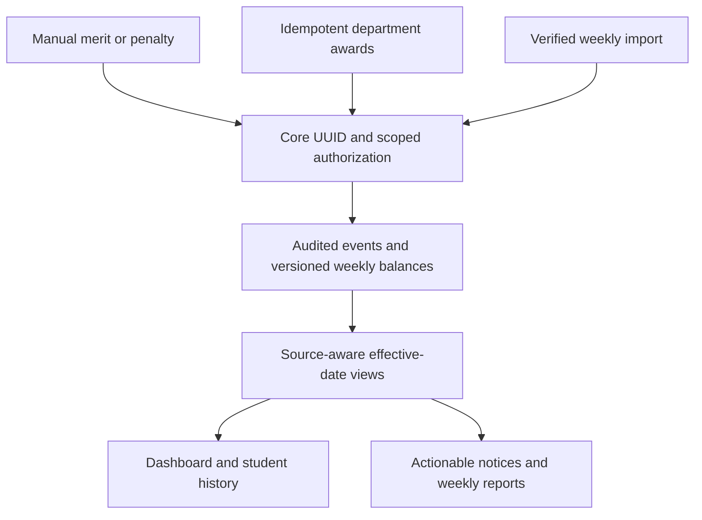
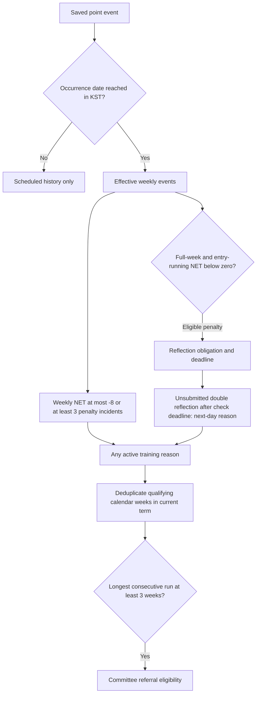

# Daniel's Scale

**Language / 언어:** [English](README.md) | [한국어](README.ko.md)

An internal student-guidance operations console for **DICS — Disciple International Christian School**. Administrators manage merit/demerit records, reflection submissions, residential-life sanctions, class notices, and weekly/settlement follow-up. Students do not sign in to this application.

[Project case study](docs/PROJECT_CASE_STUDY.md) · [Documentation](docs/README.md) · [Key issues](docs/KEY_ISSUES.md) · [Development journal](docs/DEVELOPMENT_JOURNAL.md)

**Application:** https://dics-daniels-scale.netlify.app

## From a school workflow to a shared identity model

The project began with paper discipline sheets. Integrating learning and school-service apps exposed a deeper problem: each application identified the same student differently. DICS Core separates a durable student UUID from login accounts and academic placement.

The repository records the move from a prototype to database-enforced rules, authenticated audit actors, staged UUID migration, parity checks, and a migration ledger. Historical evidence and its limits are explained in the [case study](docs/PROJECT_CASE_STUDY.md); planned work and dated operational snapshots are labeled separately from completed implementation.

## How records become operational decisions

Manual entries, Monday department awards, and imported weekly settlements share a canonical Core student UUID. The storage retains each source's precision and audit history; a weekly import never invents daily incidents. Access is scoped to authenticated roles and responsibility groups.



### Effective-day and eligibility algorithm

A future-dated entry is saved immediately for audit but excluded from current point-event scoring until its occurrence date arrives in **Asia/Seoul**. Weekly NET shown to operators is **merits minus penalties**. Reflection and training eligibility are separate calculations: a covered penalty can count as an incident without creating an actionable reflection.



The double-reflection reason ends on submission and contributes only its first qualifying week to the consecutive-week calculation. All applicable training reasons remain visible. Missing historical incident counts are not inferred; archived or superseded source rows do not participate as current events. These are eligibility signals, not automatic sanction selection.

Implementation references: [current rules](docs/DISCIPLINE_RULES.md), [source/history contract](docs/HISTORY_AND_BACKFILL.md), [effective-day projection](supabase/migrations/20261028185513_future_point_records_effective_date.sql), and [double-reflection rule](supabase/migrations/20261028120036_double_reflection_training_next_day.sql).

## Recent engineering changes

The [October commit register](docs/CHANGELOG.md#october-2026--commit-register) traces the deployment workflow, Core roster synchronization, weekly-ledger cut-over, operator corrections, reflection/training rules, bilingual documentation, and future-date effective-day scoring through October 29. Entries link to their source commits and distinguish historical operations from current policy.

## Reading paths

| Audience | Start here |
| --- | --- |
| School operators | [Operations roadmap](docs/OPERATIONS_ROADMAP.md), [individual admin accounts](docs/ADMIN_ACCOUNT_OPERATIONS.md) |
| Technical reviewers | [Core architecture](docs/DICS_CORE_ARCHITECTURE.md), [decisions](docs/DECISIONS.md), [UUID cut-over](docs/DISCIPLINE_CORE_CUTOVER.md) |
| EC/project reviewers | [Case study](docs/PROJECT_CASE_STUDY.md), [journal](docs/DEVELOPMENT_JOURNAL.md), [change log](docs/CHANGELOG.md) |
| Maintainers | [Deployment](docs/netlify-deployment.md), [migration governance](docs/CORE_MIGRATION_GOVERNANCE.md), [language policy](docs/DOCUMENTATION_POLICY.md) |

Every maintained Markdown document has an English default and a Korean counterpart with a language link at the top. [The documentation index](docs/README.md) includes historical attachments and translated reading versions.

## Local development

```bash
cp .env.example .env
# Set VITE_SUPABASE_URL and VITE_SUPABASE_ANON_KEY.
npm ci
npm run dev
```

React 19 + Vite + supabase-js form the client. PostgreSQL views/RPCs/triggers implement rules and RLS enforces permissions. Legacy login IDs seondo/sasaeng map to {login_id}@scale.dics.kr; actual individual-account adoption must be checked with the school. Follow the [account runbook](docs/ADMIN_ACCOUNT_OPERATIONS.md).

## Responsible project evidence

The development record includes Lovable, Replit, Cursor, Claude Code, and GPT-assisted work. An EC submission should identify the applicant's own decisions and implementation with specific PRs/commits; it should not claim sole authorship of the repository or unmeasured impact.

Use synthetic examples and aggregate results. Never put service_role keys in browser code or student rosters, PINs, credentials, or identity mappings in Git. A historical credential handout was replaced with a blank template; owners must review old Git objects and credential validity before sharing access. The repository remains private unless its owner changes visibility.
