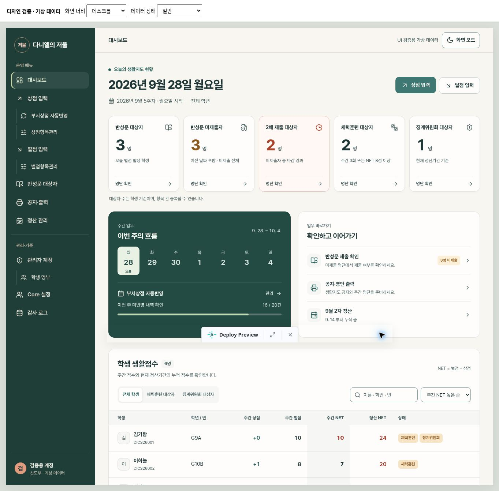

# 다니엘의 저울 UI 디자인 기준

**Language / 언어:** [English](UI_DESIGN_SYSTEM.md) | [한국어](UI_DESIGN_SYSTEM.ko.md)

## 2026-09-28 · 대시보드 기준 화면

목표는 선도부 담당자가 이번 주 맥락, 생활지도 대상자, 다음 업무를 빠르게 확인하는 것이다.
폰트·명암 개선(PR #10)에 이어 정보 위계와 간격, 반복 컴포넌트, 상태 표현을 재설계했다.

### 정보 순서

1. 오늘 날짜·요일과 월요일 기준 월 주차, 담당 학년 범위
2. 반성문 대상자 → 미제출자 → 2배 제출 대상자 → 체력훈련 → 징계위원회
3. 이번 주 달력과 부서상점 자동반영 상태, 반성문·공지·정산 업무 바로가기
4. 대상자 필터·검색·정렬을 포함한 학생별 생활점수

### 표현 규칙

- 따뜻한 종이색 기본 배경, 옅은 경계의 카드, 짙은 녹색 주간 업무 패널.
- 글꼴은 기존 Pretendard Variable. 숫자는 tabular-nums, 점수는 우측 정렬.
- 미제출이 있을 때 호박색 숫자, 2배 제출 대상이 있을 때만 붉은 배경과 숫자.
- 대상자 수는 학생 수이며 항목 간 중복 가능. 업무 화면에서 이를 명시한다.
- 요청한 카드 순서는 화면 크기와 관계없이 유지한다. 모바일은 2열+마지막 전체 너비.
- 부서상점 조회 중 / 조회 실패 / 대상 미설정 / 부분 반영 / 반영 완료를 구분한다.
- 정산기간은 전용 조회 결과로 표시한다. 학생 수가 0이어도 기간 상태를 확인할 수 있다.
- 관리자 전용 부서·정산 링크는 선도부장에게만 표시한다.
- 키보드 포커스, 의미 있는 heading·table·button·link, reduced-motion을 지원한다.

### 구성

- `src/components/dashboard.tsx`: 데이터만 전달받는 대시보드 화면. 검색·필터·정렬 및 화면 전환.
- `src/components/dashboard.css`: 대시보드 전용 스타일. 다른 관리 화면으로 확장할 시 이 기준 사용.
- `src/App.tsx`: 기존 쿼리와 담당 범위 필터를 유지하는 연결 계층.
- `src/index.css`: 공통 사이드바·상단바·콘텐츠 폭과 포커스 마감.

### 검증과 한계

- 로컬 TypeScript 검사·Vite production build 통과.
- 최초 PR CI run 36417547820 성공.
- 임시 Deploy Preview에 실제 DashboardView를 가상 데이터로 렌더링해 확인.
- 데스크톱, 390px, 320px과 다크모드 확인. 320px body/scrollWidth 모두 320으로 전체 가로 넘침 없음.
- 검색 결과 없음 → 체력훈련 카드 클릭: 검색 초기화 및 2명 표시 확인.
- 징계위원회 카드: 1명 표시, 전체 필터: 6명 복원 확인.
- 조회 실패, 설정 전, 빈 목록, 일반 선도부원에게 관리자 링크 미노출 확인.
- 브라우저에는 확장 프로그램 자체의 metadata 오류만 관찰됨. 앱 런타임 오류는 관찰되지 않음.
- 운영 계정으로 로그인한 실데이터 화면은 검증하지 않았다. 화면 테스트는 가상 데이터이며 인증 경로 우회나 운영 데이터 입력은 하지 않았다.
- agent-browser는 실행 환경에서 daemon socket bind가 차단되어 Cloud Browser로 프리뷰를 확인했다.
- 임시 public/design-review*.html은 최종 변경에서 제외. 검증에 사용한 가상 데이터는 운영 번들에 포함하지 않는다.

